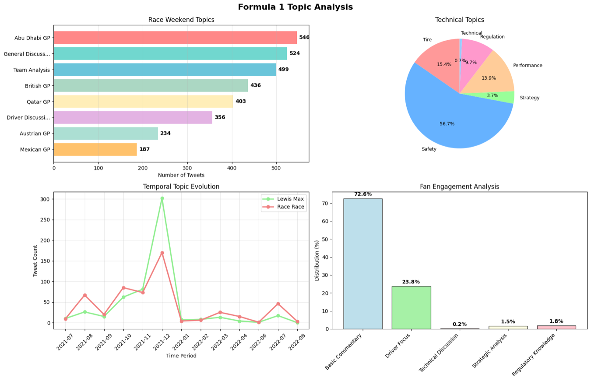

# Formula 1 Tweet Analysis

A Grand Prix hashtag tells you which race people are discussing. The tweets reveal what caught their attention, from a fight for the lead to a pit stop or a safety car. This project uses topic modeling to find those conversations across Formula 1 tweets.



## From tweets to topics

The analysis starts with a random sample of 45,000 tweets from the [Formula 1 Trending Tweets dataset](https://www.kaggle.com/datasets/kaushiksuresh147/formula-1-trending-tweets). After filtering for English and Formula 1 relevance, removing duplicates, and cleaning the text, 26,571 tweets remained. The notebook sets up BERTweet and fits BERTopic to discover groups of related tweets.

The saved run grouped 19,248 tweets into 248 topics. The largest group included discussion of Lewis Hamilton, Max Verstappen, and the Abu Dhabi Grand Prix. Other clusters centered on race weekends and themes such as Mercedes and porpoising. The run recorded **0.5702 Cᵥ topic coherence**.

[Open the notebook](notebooks/f1_topic_modeling.ipynb) to explore the topic breakdown, charts, and how they were produced. Read the [project report (Word)](docs/f1topicmodellingdocumentation.docx) for the write-up.

## Run locally

From the repository root, use Python 3.12 to set up the environment and open the notebook.

```bash
python3.12 -m venv .venv
source .venv/bin/activate
python -m pip install -r requirements.txt
python -m notebook notebooks/f1_topic_modeling.ipynb
```

Run the cells from top to bottom. The notebook downloads the dataset through KaggleHub, along with BERTweet and the NLTK resources.
